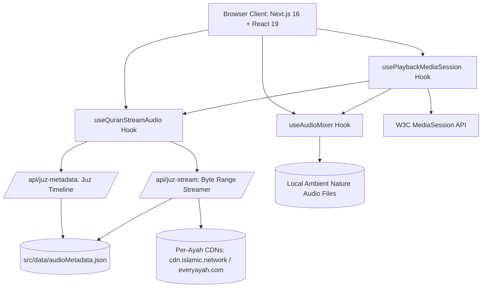

# System Architecture — Peaceful Quran

[← Back to AGENT.md](../AGENT.md)

---

## 1. Executive Overview

**Peaceful Quran** is a modern, high-performance web application designed to deliver an immersive spiritual experience. It seamlessly blends continuous streaming of the Holy Quran (recitation organized by Juz) with a customizable multi-channel ambient nature sound mixer.



---

## 2. Audio Streaming Architecture

### 2.1 Per-Ayah Sources, One Continuous Stream

Recitation audio comes from per-ayah MP3 files, one URL template per reciter (`ayahAudioTemplate` in `src/lib/quranStream.ts`). The server concatenates the ayahs of a Juz into one continuous MP3 (`/api/juz-stream`), so the browser's native media pipeline plays a whole Juz with no JavaScript between ayahs — the key to surviving a locked screen.

- **10 Reciters**: 9 Arabic reciters plus an Urdu translation (`RECITERS_LIST`).
- **Exact Juz boundaries**: `JUZ_START_AYAH` and `SURAH_AYAH_COUNTS` define the Hafs divisions, so each Juz starts and ends on the correct ayah (whole-surah files cannot do this).

### 2.2 Generated Audio Metadata (`scripts/generateAudioMetadata.mjs`)

`pnpm generate:audio` probes every ayah file of every reciter (HTTP Range reads of the header and tail only) and writes `src/data/audioMetadata.json`:

- One `[firstAudioByte, audioLength, durationMs, formatCode?]` tuple per ayah. ID3 tags, junk bytes and the Xing/Info header are excluded, so ayahs concatenate into a clean MP3 stream.
- **Exact durations**: Xing frame counts, CBR byte math, or a full frame scan for variable-bitrate files. Reciters differ (128 kbps / 44.1 kHz vs 64 kbps / 22.05 kHz), so durations are never derived from file size with an assumed bitrate.
- **Format-uniform segments**: Chrome aborts playback (`Unsupported midstream configuration change`) when the sample rate or channel count changes mid-stream. A file in a different format is replaced by a same-reciter alternate source when one exists; otherwise the Juz is split into segments at each format change (e.g. Abu Bakr Al Shatri's 11 kHz surahs, which no source offers at 44.1 kHz).
- A content `version` is appended to stream URLs, so caches are bypassed whenever the metadata is regenerated.

Re-run the script after changing a reciter's `ayahAudioTemplate` or adding a reciter. Probe results are cached between runs (`--cache=<file>`).

### 2.3 Server-Side Streaming Engine

Powered by `src/lib/streamServer.ts`:

- **`/api/juz-metadata?juz&reciter`**: the Juz timeline — total duration, segment stream URLs and per-ayah start/end times — used for progress display and the current surah/ayah.
- **`/api/juz-stream?juz&reciter&segment[&from][&v]`**: HTTP 206 range streaming of one segment. Byte ranges are mapped onto per-ayah slices, fetched from the CDN with `Range` requests.
- **Backpressure**: bytes are pulled from the CDN only as fast as the client reads them; the next slice is requested ahead of time to hide CDN latency.
- **Exact lengths**: every slice contributes exactly its expected byte count (short upstream reads are resumed once, then zero-padded), so `Content-Length` and later offsets never drift.
- **Bounded responses**: open-ended `bytes=N-` requests (Chrome, Android WebView) are answered with at most 2 MiB; the browser requests the next range itself, so no function invocation streams a whole Juz.
- **`from=<ayahNumber>`** starts a segment stream at an ayah — used to resume after a network failure and when switching reciters mid-Juz.

### 2.4 Client Playback (`useQuranStreamAudio`)

- One persistent `HTMLAudioElement`. A Juz's segments, then the next Juz, are chained in the `ended` handler. The next Juz's timeline is prefetched, so the switch happens synchronously inside `ended` (no network round trip while the screen is locked).
- **Intent vs. state**: `wantsPlaybackRef` records whether the listener wants audio. Browsers fire `pause` right before `ended`, so `isPlaying` alone cannot decide whether to continue.
- **Recovery**: one silent retry after a media error, then an inline error with Retry; both resume at the current ayah.
- Juz, reciter and volume persist in `localStorage` (`peaceful-quran:player`).
- Seeking is intentionally not offered (progress is display-only): browsers can only estimate byte offsets inside a concatenated stream.

### 2.5 Lock-Screen & Background Playback Survival

1. **W3C MediaSession API**: `usePlaybackMediaSession` (built on `useMediaSession`) is the single owner of the page-wide session for both the recitation and the ambient mixer. It provides play/pause, previous/next Juz, position state and artwork; pause silences both players and play resumes what was paused.
2. **Synchronous Ref Delegation**: audio event handlers read mutable refs (`wantsPlaybackRef`, `juzRef`, `metadataRef`, …) so lock-screen events never act on stale state.

### 2.6 Safari HLS Dynamic Playlist (`/api/hls/playlist`)

Experimental and not used by the player: generates `#EXTM3U` VOD playlists of whole-surah files for Apple WebKit.

---

## 3. Ambient Sound Mixer Architecture

The ambient mixer (`src/hooks/useAudioMixer.ts` & `src/components/AmbianceMixer.tsx`) operates in parallel with Quran recitation:

- **3 Looping Sound Channels**: Rain, Thunder and Birds (`SOUNDS`). Files are only downloaded once a sound is turned up.
- **Independent Volume Control**: Each track maintains an independent gain level between 0% and 100%.
- **Presets**: `Calm`, `Storm` and `Forest`, plus Reset.
- **Independent Audio Instances**: Managed independently so adjusting ambient sound volumes never interrupts or distorts recitation.

---

## 4. State Management & Data Flow

```
[page.tsx]  (container: owns both players)
       │
       ├── useQuranStreamAudio ───► HTMLAudioElement ◄── /api/juz-stream
       │         ▲                        timeline ◄──── /api/juz-metadata
       │         │
       ├── useAudioMixer ─────────► Multi-channel Audio Pool
       │         ▲
       └── usePlaybackMediaSession (lock screen / headset controls for both)

[QuranPlayer] [AmbianceMixer]  ◄── presentation components, receive hook state as props
Redux Store ───► themeSlice (Active Theme State)
```

- **Audio State**: Encapsulated within custom hooks (`useQuranStreamAudio`, `useAudioMixer`) called by the page and passed to presentation components as props. `AmbianceMixer` is memoized, so playback progress ticks don't re-render it.
- **Theme State**: Persisted globally via Redux Toolkit (`themeSlice.ts`), supporting instant theme swapping across all glassmorphic components.

---

## 5. Directory Structure & Key Responsibilities

```
web/
├── scripts/
│   └── generateAudioMetadata.mjs    # Probes CDN audio → src/data/audioMetadata.json
├── src/
│   ├── app/
│   │   ├── api/
│   │   │   ├── juz-metadata/route.ts # Juz timeline (segments, ayah times)
│   │   │   ├── juz-stream/route.ts   # Byte-range audio stream server
│   │   │   └── hls/playlist/         # Experimental HLS VOD playlist (unused)
│   │   ├── layout.tsx               # Root Next.js layout & font setup
│   │   ├── manifest.ts              # Web app manifest
│   │   ├── page.tsx                 # Main application page (/)
│   │   └── providers.tsx            # Redux Provider wrapper
│   ├── components/
│   │   ├── QuranPlayer.tsx          # Main glassmorphic player card
│   │   ├── AmbianceMixer.tsx        # Nature sounds mixer card
│   │   └── ui/                      # Atomic UI design components
│   ├── data/
│   │   └── audioMetadata.json       # Generated per-ayah audio map (do not edit by hand)
│   ├── hooks/
│   │   ├── useQuranStreamAudio.ts   # Core stream playback hook
│   │   ├── useAudioMixer.ts         # Multi-channel ambient mixer hook
│   │   ├── usePlaybackMediaSession.ts # Single Media Session owner for both players
│   │   ├── useMediaSession.ts       # W3C MediaSession API primitive
│   │   ├── useDrawerDismiss.ts      # Escape / back-button dismissal for drawers
│   │   └── useTheme.ts              # Theme selector hook
│   ├── lib/
│   │   ├── quranStream.ts           # Reciters, Quran structure, shared API types, formatters
│   │   ├── streamServer.ts          # Server-side byte mapping & stream pipe
│   │   ├── themes.ts                # Theme token definitions
│   │   └── utils.ts                 # ClassName merging (cn) utility
│   └── store/                       # Redux store & slices
└── docs/                            # Architectural, design, & rule specs
```

---

[← Back to AGENT.md](../AGENT.md)
